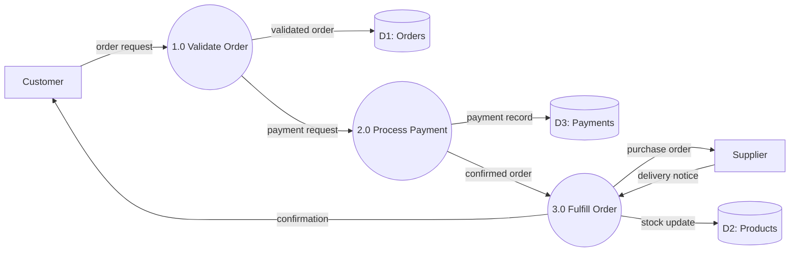

# Data Flow Diagrams

Context diagrams, level 0/1 decomposition, data stores, and process modeling.

## When to Load

- Mapping how data moves through a system
- Communicating system boundaries to non-technical stakeholders
- Decomposing complex processes into understandable layers
- Identifying data stores and their relationships to processes

## Key Concepts

**Context Diagram (Level 0)** -- Single process representing the entire system. Shows external entities (actors/systems) and data flows in/out. Defines system boundary.

**Level 1** -- Decompose the single process into 3-7 sub-processes. Show data stores. Flows between processes must be labeled with what data moves.

**Level 2+** -- Further decomposition of individual Level 1 processes. Each level adds detail. Stop when processes are simple enough to describe in a paragraph.

**Elements** -- External entities (rectangles), processes (circles/rounded rectangles), data stores (open-ended rectangles/parallel lines), data flows (labeled arrows).

**Rules** -- No flow between two external entities (that is outside your system). No flow between two data stores (a process must mediate). Every process has at least one input and one output.

## Patterns

```
# Context Diagram (Level 0)
+----------+                         +----------+
| Customer | --order request-------> |          |
|          | <--order confirmation-- |  Order   |
+----------+                         |  System  |
                                     |          |
+----------+                         |          |
| Supplier | <--purchase order------ |          |
|          | --delivery notice-----> |          |
+----------+                         +----------+

# Level 1 Decomposition
External: Customer, Supplier
Processes:
  1.0 Validate Order
  2.0 Process Payment
  3.0 Fulfill Order
  4.0 Manage Inventory

Data Stores:
  D1: Orders
  D2: Products
  D3: Payments

Flows:
  Customer -> 1.0: order details
  1.0 -> D1: validated order
  1.0 -> 2.0: payment request
  2.0 -> D3: payment record
  2.0 -> 3.0: confirmed order
  3.0 -> D2: stock update
  3.0 -> Supplier: purchase order
  4.0 -> D2: inventory levels
```



## Gotchas

- Trying to show everything in one diagram -- use levels for progressive detail
- Data flows without labels are meaningless -- always name what is flowing
- Processes without both input and output indicate incomplete analysis
- Confusing DFDs with flowcharts -- DFDs show data movement, not control flow or decisions
- Numbering processes inconsistently between levels breaks traceability

## Verification

- Context diagram has exactly one process (the system)
- Every Level 1 process can be traced back to the context diagram
- All data flows are labeled with the data content (not the action)
- No direct flows between external entities or between data stores
- Inputs and outputs balance between levels (data in at Level 0 appears at Level 1)
