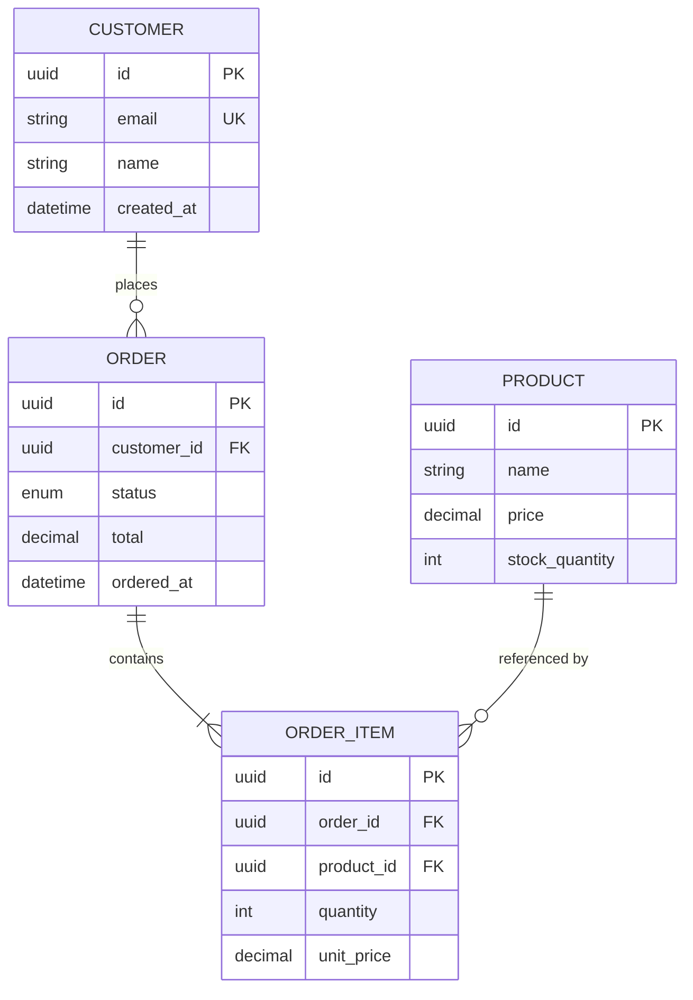

# Entity-Relationship Diagrams

Crow's foot notation, entity modeling, relationships, and cardinality for data analysis.

## When to Load

- Modeling database schemas visually
- Documenting data relationships for stakeholders
- Designing new data structures
- Reviewing existing database designs

## Key Concepts

**Crow's Foot Notation** -- Standard for ERDs. Line endings indicate cardinality: single line (one), crow's foot/fork (many), circle (zero/optional), dash (one/mandatory).

**Entities** -- Nouns in the domain. Represented as rectangles. Contain attributes with types. Have a primary key (PK) that uniquely identifies each row.

**Relationships** -- Named connections between entities. Read as sentences: "Customer PLACES Order", "Order CONTAINS OrderItem". Always label with a verb.

**Cardinality** -- How many of each entity participate: one-to-one (1:1), one-to-many (1:N), many-to-many (M:N). M:N requires a junction/bridge table in implementation.

**Optionality** -- Whether participation is required (mandatory) or optional. A user MAY have zero addresses (optional) but MUST have one email (mandatory).

## Patterns

```
# Cardinality notation (Crow's Foot)
||--||  one and only one (mandatory both sides)
||--o{  one to zero-or-many
||--|{  one to one-or-many (mandatory)
}o--o{  zero-or-many to zero-or-many (M:N)

# Reading relationships
CUSTOMER ||--o{ ORDER : "places"
  -> One customer places zero or many orders
  -> Each order belongs to exactly one customer

ORDER ||--|{ ORDER_ITEM : "contains"
  -> One order contains one or many items
  -> Each item belongs to exactly one order

PRODUCT }o--o{ CATEGORY : "belongs to"
  -> A product belongs to zero or many categories
  -> A category contains zero or many products
  -> (Implemented via PRODUCT_CATEGORY junction table)
```



## Gotchas

- M:N relationships cannot be directly implemented -- always show the junction table
- Confusing optionality with cardinality: "zero-or-many" is both optional AND many
- Self-referencing relationships (employee manages employee) need clear role labels
- Over-normalizing in the diagram makes it unreadable -- show logical model, not physical
- Missing foreign keys in the diagram hides how relationships are actually implemented

## Verification

- Every relationship can be read as a grammatically correct sentence
- Cardinality matches business rules (ask: "Can a customer have zero orders? Must they?")
- M:N relationships have explicit junction tables shown
- Primary and foreign keys are marked on all entities
- Diagram matches the actual database schema (or documents intended target state)
