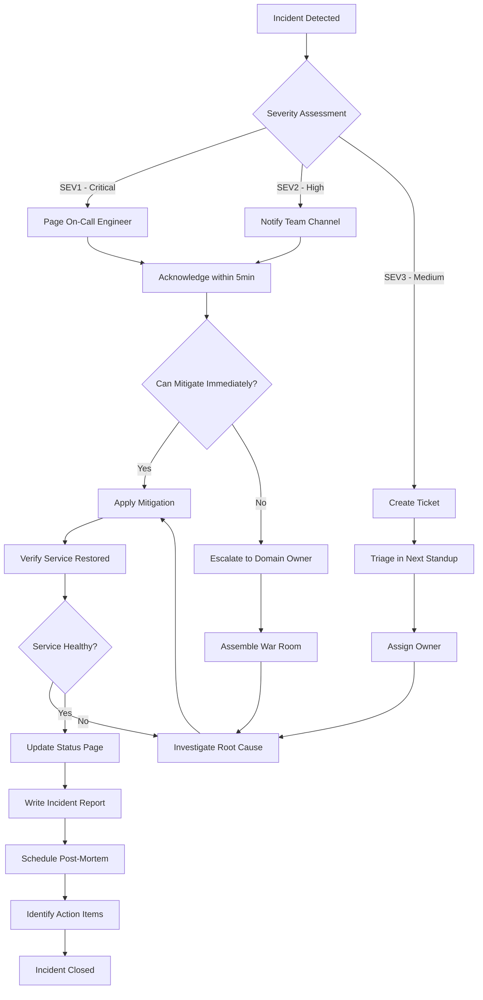

# Incident Response BPMN Process

## Context
When documenting an incident management workflow from detection through resolution and post-mortem. This BPMN model captures roles, decision points, escalation paths, and SLA timers.

## Code/Template

### Process Diagram (Mermaid)



### BPMN Specification (Textual)

```
Process: Incident Response
Participants: Monitoring System, On-Call Engineer, Incident Commander, Domain Owner

Pool: Incident Management
─────────────────────────────────────────────────────────────

Lane: Monitoring System
  Start Event: Alert Triggered (metric threshold breached OR error rate spike)
  Task: Classify Severity [Service Task - automated]
    Rules:
      - Customer-facing outage + >5% users affected → SEV1
      - Degraded performance + >1% users affected → SEV2  
      - Internal system error, no user impact → SEV3
  Message Event: Send Alert (to On-Call)

Lane: On-Call Engineer
  Message Event: Receive Alert
  Timer Event: 5-minute acknowledgment SLA
    Escalation: If not acknowledged → page backup on-call + engineering manager
  Task: Acknowledge Incident [User Task]
  Gateway: Can resolve without escalation? (Exclusive)
    Yes → Task: Apply Known Runbook [User Task]
    No → Task: Escalate to Incident Commander [User Task]

Lane: Incident Commander
  Task: Open War Room [User Task]
  Task: Assign Roles [User Task]
    - Communications Lead (status page updates)
    - Technical Lead (drives investigation)
    - Scribe (documents timeline)
  Sub-Process: Investigation & Resolution
    Task: Form Hypothesis [User Task]
    Task: Gather Evidence (logs, metrics, traces) [User Task]
    Gateway: Root Cause Identified? (Exclusive)
      No → Task: Expand Blast Radius Analysis → loop back
      Yes → Task: Implement Fix [User Task]
    Task: Validate Fix in Production [User Task]
    Gateway: Service Restored? (Exclusive)
      No → loop to Form Hypothesis
      Yes → End Sub-Process
  Task: Declare Incident Resolved [User Task]
  Timer Event: 48-hour deadline for post-mortem

Lane: Domain Owner
  Task: Write Post-Mortem [User Task]
    Contents: timeline, root cause, impact, contributing factors, action items
  Task: Present at Post-Mortem Meeting [User Task]
  Task: Create Follow-Up Tickets [User Task]
  End Event: Incident Closed
```

### SLA Matrix

| Severity | Acknowledge | Mitigate | Resolve | Post-Mortem |
|----------|-------------|----------|---------|-------------|
| SEV1 | 5 min | 30 min | 4 hours | 48 hours |
| SEV2 | 15 min | 2 hours | 24 hours | 1 week |
| SEV3 | 1 hour | 8 hours | 1 week | Optional |

### Escalation Rules

```yaml
escalation_policy:
  sev1:
    - t+0m: page primary on-call
    - t+5m: page secondary on-call + engineering manager
    - t+15m: page VP engineering + create status page incident
    - t+30m: executive notification if no mitigation
  sev2:
    - t+0m: notify team Slack channel
    - t+15m: page primary on-call if no acknowledgment
    - t+2h: escalate to engineering manager if no mitigation
  sev3:
    - t+0m: create Jira ticket, assign to team queue
    - t+24h: auto-escalate to team lead if unassigned
```

## Key Points
- Timer boundary events enforce SLAs: if acknowledgment doesn't happen within 5 minutes for SEV1, automatic escalation fires. This is modeled as an interrupting boundary timer.
- The investigation sub-process is a loop — you form a hypothesis, gather evidence, validate. This maps to real incident work better than a linear flow.
- Post-mortem is a required output (not optional) for SEV1/SEV2. The 48-hour timer creates accountability without blocking resolution.
