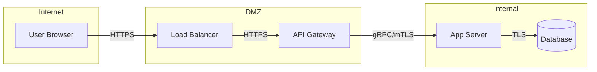

# Data Flow Diagram Creation Prompt

## Purpose
Create data flow diagrams (DFDs) identifying trust boundaries, data stores, processes, and external entities as input to threat modeling.

## When to Use
- Starting a STRIDE threat model for a system
- Documenting data flows for compliance (GDPR, HIPAA data mapping)
- Onboarding security reviewers to a system's architecture
- Identifying where sensitive data crosses trust boundaries

## Prompt Template

```
You are a security architect creating a data flow diagram for threat modeling.

CONTEXT:
- System: {system_name_and_purpose}
- Architecture: {monolith|microservices|serverless|hybrid}
- Deployment: {cloud_provider|on_prem|hybrid}
- Data sensitivity: {public|internal|confidential|restricted}
- Existing documentation: {architecture_diagrams|API_specs|none}

SYSTEM DESCRIPTION:
{describe_the_system_components_and_their_interactions}

CREATE THE DFD WITH:

1. EXTERNAL ENTITIES (rectangles)
   - Users (by role: admin, customer, anonymous)
   - Third-party services (payment, email, auth provider)
   - Partner systems (B2B integrations)
   - Tag: trusted/untrusted

2. PROCESSES (circles)
   - Application components that transform data
   - Background jobs and workers
   - API gateways and load balancers
   - Tag: privilege level, language/framework

3. DATA STORES (parallel lines)
   - Databases (type, what's stored)
   - Caches (what's cached, TTL)
   - File storage (what files, who accesses)
   - Message queues (what messages flow)
   - Tag: encryption state, access control

4. DATA FLOWS (arrows)
   - Protocol used (HTTPS, gRPC, SQL, AMQP)
   - Data classification of what flows
   - Authentication mechanism on the flow
   - Direction (one-way, bidirectional)

5. TRUST BOUNDARIES (dashed lines)
   - Internet ↔ DMZ
   - DMZ ↔ Internal network
   - Service ↔ Service (different teams/trust levels)
   - Application ↔ Third-party
   - User device ↔ Backend

6. THREAT SURFACE IDENTIFICATION
   - Every flow crossing a trust boundary = potential attack surface
   - Data stores accessible from multiple trust zones
   - Processes with elevated privileges
   - Points where data classification changes (encrypted → plaintext)

RULES:
- Level 0 first (system context), then Level 1 (component detail)
- Every flow must have: protocol, data type, auth mechanism
- Mark flows carrying sensitive data (PII, credentials, financial)
- Identify where encryption terminates (TLS termination point)
- Note any implicit trust assumptions
```

## Output Format

```markdown
## Data Flow Diagram

### Level 0: System Context
[Mermaid or text-based diagram showing system boundary and external entities]

### Level 1: Component Detail
[Expanded view of internal components]

### Trust Boundaries
| Boundary | Between | Crossing Flows | Controls |
|----------|---------|---------------|----------|

### Data Classification Map
| Data Type | Classification | Stores | Flows Through | Encrypted |
|-----------|---------------|--------|---------------|-----------|

### Threat Surface Summary
| Crossing Point | Protocol | Auth | Data Sensitivity | Risk |
|---------------|----------|------|-----------------|------|

### Diagram (Mermaid)


### Assumptions and Gaps
- [Implicit trust assumptions identified]
- [Areas needing clarification from development team]
```
