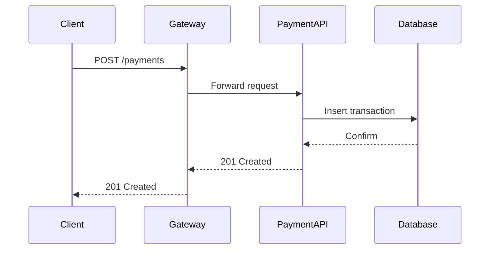

# Diagram Tools Comparison

Selecting the right diagramming tool for technical documentation.

## Mermaid

Text-based diagrams rendered in Markdown:

### Strengths
- Native support in GitHub, GitLab, Notion, Backstage
- No separate tooling needed — renders inline in Markdown files
- Version control friendly (plain text diffs)
- Good for: flowcharts, sequence diagrams, ER diagrams, Gantt charts

### Limitations
- Limited layout control (auto-layout only)
- Complex diagrams become unreadable in source
- No custom styling beyond theme presets
- Large diagrams render poorly (>15 nodes gets crowded)

### Example

````markdown

````

### Best For
- README diagrams, PR descriptions, inline documentation
- Teams that want diagrams in version control without external tools

## PlantUML

Mature text-to-diagram tool with extensive diagram type support:

### Strengths
- Widest diagram type coverage (UML, network, Gantt, mindmap, JSON, YAML)
- C4 model support via `C4-PlantUML` library
- Customizable themes and skinparams
- Server-side rendering (plantuml-server Docker image)

### Limitations
- Java dependency for local rendering
- Syntax can be verbose for simple diagrams
- Layout algorithm sometimes produces unexpected results
- Less modern look compared to D2 or Excalidraw

### Example

```plantuml
@startuml
!include C4_Container.puml

Person(user, "Customer", "Places orders")
System_Boundary(system, "E-Commerce") {
    Container(web, "Web App", "React", "Customer-facing UI")
    Container(api, "API", "Go", "Business logic")
    ContainerDb(db, "Database", "PostgreSQL", "Orders and inventory")
}
Rel(user, web, "Uses", "HTTPS")
Rel(web, api, "Calls", "gRPC")
Rel(api, db, "Reads/Writes", "SQL")
@enduml
```

### Best For
- UML-heavy documentation, enterprise architecture, C4 diagrams
- Teams with existing PlantUML infrastructure

## D2

Modern declarative diagramming language:

### Strengths
- Clean, readable syntax (less ceremony than PlantUML)
- Multiple layout engines (dagre, ELK, TALA)
- Markdown text in shapes
- Animated connections (for presentations)
- Built-in themes with modern aesthetics
- Standalone binary — no runtime dependencies

### Limitations
- Younger project (smaller community, fewer integrations)
- No native GitHub/GitLab rendering (needs CI step to generate images)
- Limited UML-specific diagram types
- TALA layout engine (best quality) requires license

### Example

```d2
direction: right

client: Customer {
  shape: person
}
gateway: API Gateway
payment: Payment Service {
  handler: Request Handler
  validator: Input Validator
  processor: Payment Processor
}
db: PostgreSQL {
  shape: cylinder
}

client -> gateway: POST /pay
gateway -> payment.handler
payment.handler -> payment.validator
payment.validator -> payment.processor
payment.processor -> db: INSERT
```

### Best For
- Architecture diagrams with modern aesthetics
- Teams wanting better layout quality than Mermaid without PlantUML's verbosity

## Structurizr

C4-model-first diagramming tool:

### Strengths
- Purpose-built for C4 architecture diagrams
- Single model, multiple views (one source of truth)
- DSL for defining architecture models
- Auto-generates all C4 levels from same model
- Exports to PlantUML, Mermaid, DOT, PNG, SVG

### Limitations
- C4-only (not a general diagramming tool)
- Structurizr Lite is free, cloud version is paid
- Opinionated about diagram semantics
- Requires understanding C4 model concepts

### Example (DSL)

```
workspace {
    model {
        user = person "Customer"
        system = softwareSystem "Payment Platform" {
            api = container "Payment API" "Go" "Handles payment requests"
            db = container "Database" "PostgreSQL" "Stores transactions"
        }
        user -> system "Makes payments"
        api -> db "Reads and writes"
    }
    views {
        systemContext system "Context" {
            include *
            autoLayout
        }
        container system "Containers" {
            include *
            autoLayout
        }
    }
}
```

### Best For
- Teams committed to C4 methodology
- Architecture documentation that needs consistent multi-level views

## Excalidraw

Hand-drawn style collaborative diagramming:

### Strengths
- Intuitive drag-and-drop interface
- Hand-drawn aesthetic (approachable, non-intimidating)
- Real-time collaboration
- `.excalidraw` files are JSON (version-controllable)
- Embeddable in documentation systems
- Libraries of reusable shapes (AWS, GCP, Kubernetes icons)

### Limitations
- Not text-based (harder to diff in PRs)
- Manual layout (no auto-layout from code)
- Large diagrams in JSON become noisy in git diffs
- No programmatic generation

### Best For
- Whiteboarding sessions, brainstorming, quick sketches
- Documentation where approachable visuals matter more than precision

## Decision Matrix

| Factor | Mermaid | PlantUML | D2 | Structurizr | Excalidraw |
|--------|---------|----------|-----|-------------|------------|
| Learning curve | Low | Medium | Low | Medium | Very low |
| Text-in-repo | Yes | Yes | Yes | Yes | Partial (JSON) |
| GitHub render | Native | Needs action | Needs action | Export only | Image only |
| Layout control | None | Limited | Good (ELK) | Auto only | Full manual |
| Diagram types | Many | Most | General | C4 only | Freeform |
| Modern aesthetics | Medium | Low | High | Medium | High |
| Collaboration | Via git | Via git | Via git | Cloud version | Real-time |
| CI integration | Easy | Medium | Easy | Medium | Hard |

## Recommended Strategy

- **Quick inline docs**: Mermaid (zero tooling, renders everywhere)
- **Architecture decisions**: D2 or Structurizr (depending on C4 commitment)
- **Detailed UML/C4**: PlantUML with C4 extension (mature, well-supported)
- **Workshops and brainstorming**: Excalidraw (collaborative, low friction)
- **Generated diagrams**: D2 or Mermaid (easy to template and script)

## Workflow Integration

1. Store diagram source in repo alongside documentation
2. CI pipeline renders to PNG/SVG on merge
3. Generated images committed or published to artifact store
4. Documentation site references rendered images
5. PR reviews include diagram source diffs with rendered preview (GitHub Actions can post image comments)
