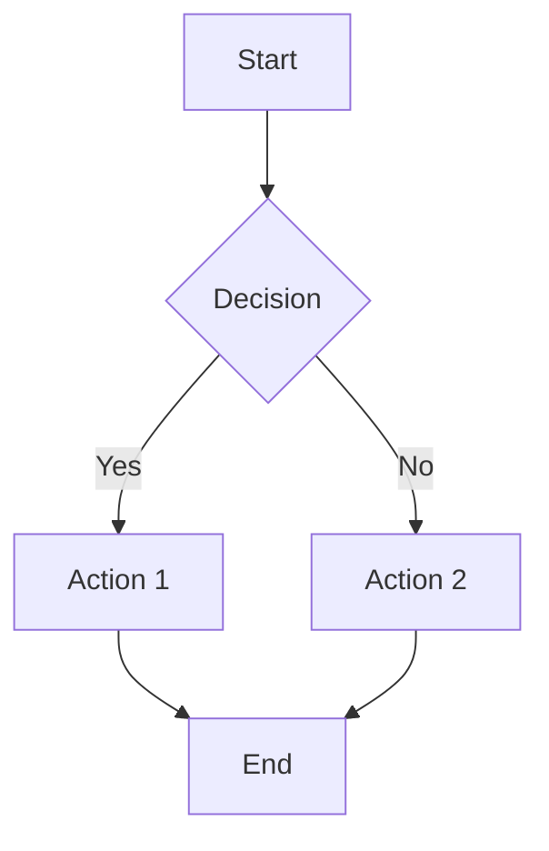
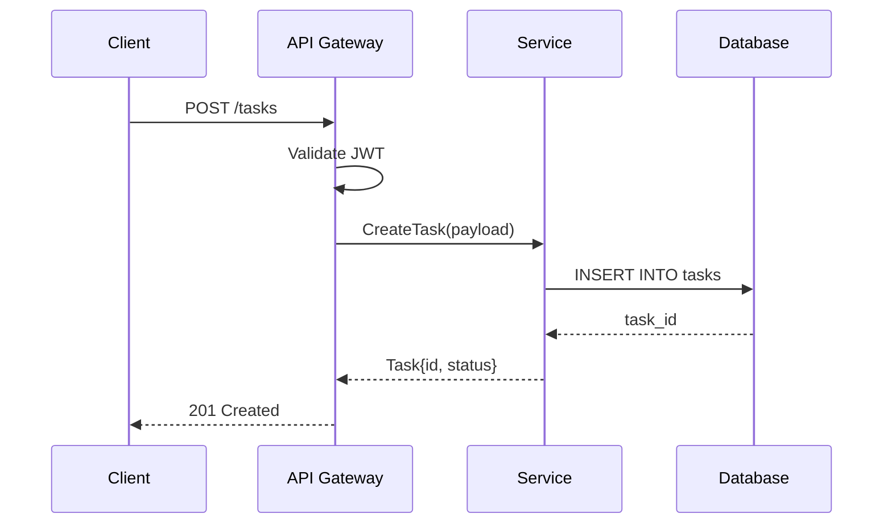
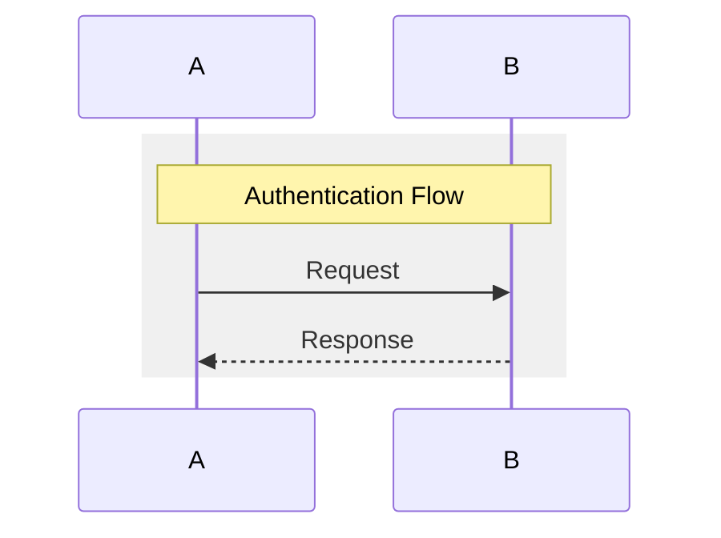
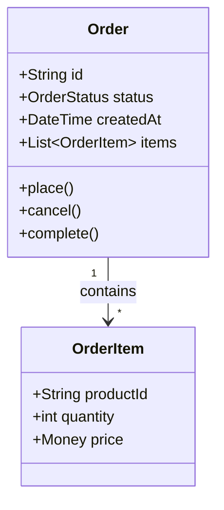
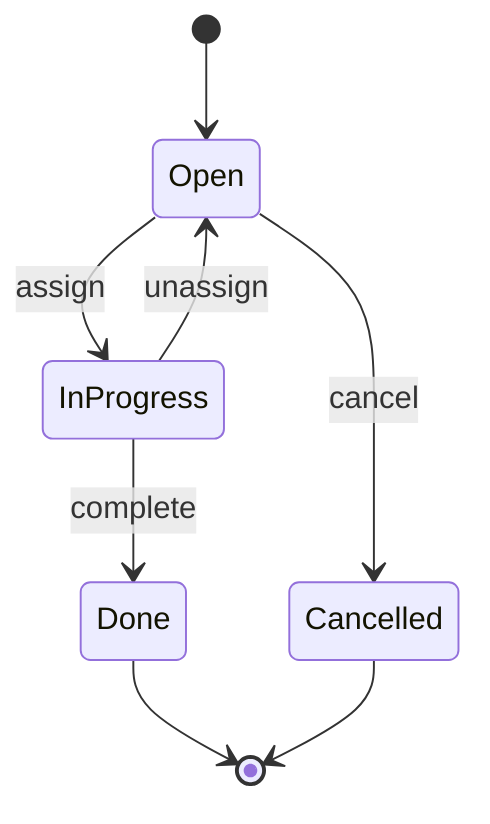
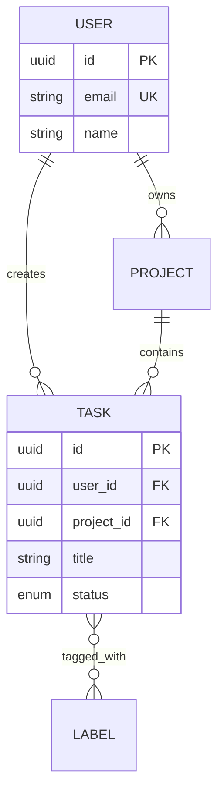
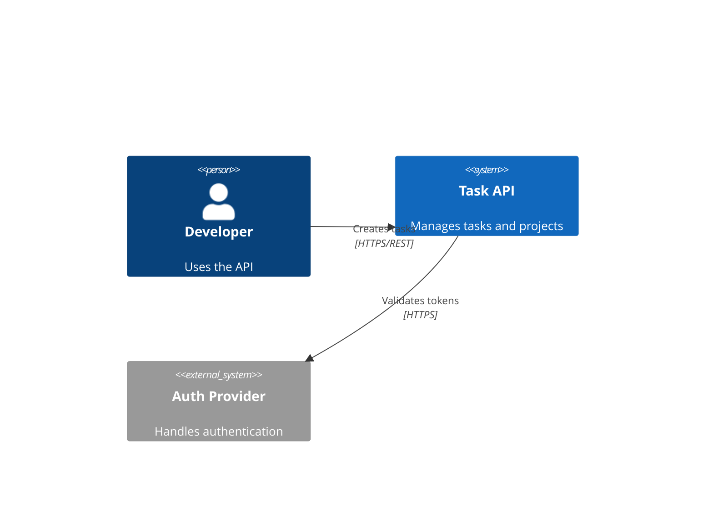
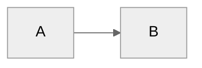
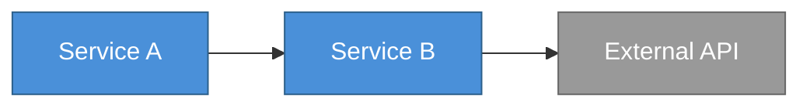

# Mermaid Reference

Syntax guide for creating diagrams in Mermaid (natively rendered by GitHub, GitLab, and most doc platforms).

## Diagram Types

### Flowchart

Direction options: `TD` (top-down), `LR` (left-right), `BT` (bottom-top), `RL` (right-left)

Node shapes:
- `[text]` -- rectangle
- `(text)` -- rounded rectangle
- `{text}` -- diamond (decision)
- `[(text)]` -- cylinder (database)
- `[[text]]` -- subroutine
- `((text))` -- circle

Edge types:
- `-->` -- arrow
- `---` -- line (no arrow)
- `-.->` -- dotted arrow
- `==>` -- thick arrow
- `-->|label|` -- labeled edge

### Sequence Diagram

Arrow types:
- `->>` -- solid arrow (synchronous)
- `-->>` -- dashed arrow (response)
- `--)` -- async message (no response expected)
- `--x` -- cross (failure/rejection)

Grouping:

### Class Diagram

Relationships:
- `-->` -- association
- `--|>` -- inheritance
- `..|>` -- implementation
- `--*` -- composition
- `--o` -- aggregation

### State Diagram

### Entity Relationship

Cardinality:
- `||` -- exactly one
- `o|` -- zero or one
- `}|` -- one or more
- `}o` -- zero or more

### C4 Context (using Mermaid C4 extension)

## Styling

### Theme

Available themes: `default`, `neutral`, `dark`, `forest`

### Custom Styles

## Complexity Limits

| Diagram type | Max elements | If exceeded |
|--------------|-------------|-------------|
| Flowchart | 12 nodes | Split into sub-diagrams |
| Sequence | 7 participants, 15 interactions | Split into phases |
| Class | 8 classes | Focus on one bounded context |
| ER | 10 entities | Split by domain/module |
| State | 8 states | Decompose into nested states |

## Best Practices

1. Title every diagram with a comment: `%% Order Processing Flow`
2. Use aliases for long names: `participant GW as API Gateway`
3. Group related interactions in sequence diagrams using `rect`
4. Use consistent node naming: PascalCase for systems, camelCase for actions
5. Keep labels short (under 5 words)
6. Use notes for clarification: `Note over A,B: Async via queue`
7. Test rendering in target platform before committing
