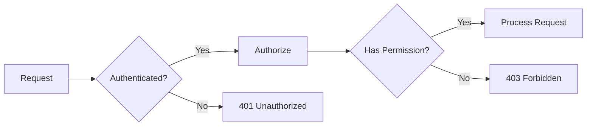
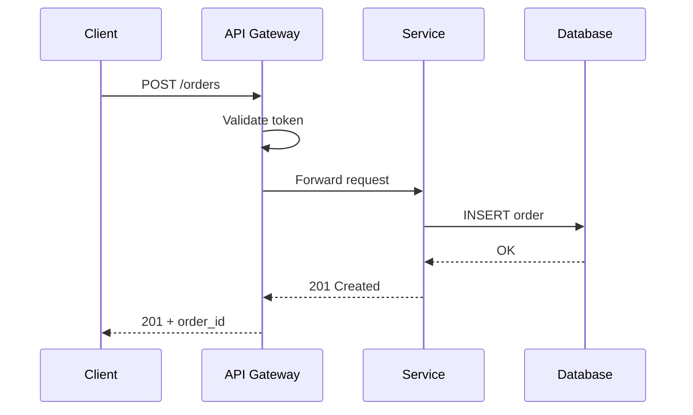
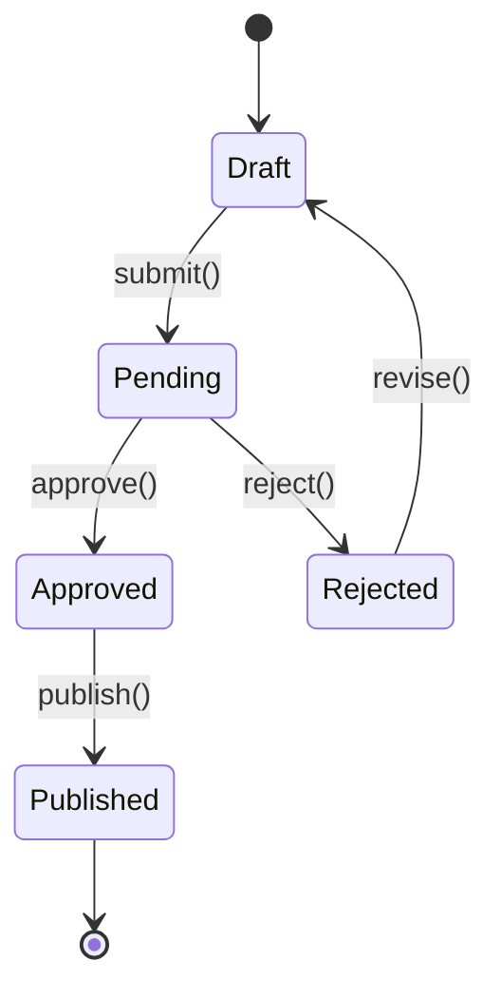
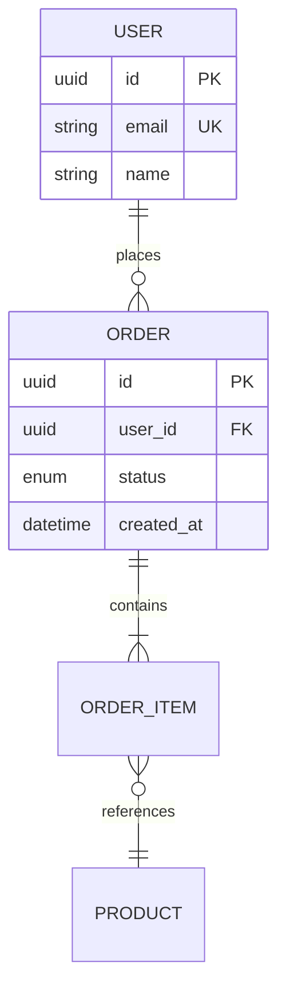

# Mermaid Diagrams

Flowcharts, sequence diagrams, class diagrams, state machines, ER diagrams, and Gantt charts using Mermaid.

## When to Load

- Creating diagrams in markdown documentation
- Visualizing system interactions or data flow
- Generating diagrams from text that can live in version control
- Choosing the right diagram type for the content

## Key Concepts

**Flowchart** -- Directed graphs for processes and decisions. Nodes (shapes), edges (arrows with labels). Directions: TB (top-bottom), LR (left-right), BT, RL.

**Sequence Diagram** -- Interactions between participants over time. Messages (sync/async), activations, loops, alt/opt blocks, notes.

**Class Diagram** -- Relationships between types. Inheritance, composition, aggregation, association. Methods and properties with visibility markers.

**State Diagram** -- State transitions for a single entity. States, transitions with triggers, nested states, fork/join for parallelism.

**ER Diagram** -- Entity-relationship for data modeling. Entities, attributes, relationships with cardinality (one-to-many, many-to-many).

## Patterns

## Gotchas

- Long labels on edges make diagrams unreadable -- use short labels and add a legend
- Mermaid rendering differs between GitHub, GitLab, Docusaurus, and VS Code preview
- Sequence diagrams with 10+ participants become horizontal scrolling nightmares -- split into sub-diagrams
- State diagrams do not support guards/conditions natively -- use labels on transitions
- ER diagrams in Mermaid have limited attribute type support compared to dedicated tools

## Verification

- Diagram renders correctly in the target platform (preview before committing)
- Flow direction matches reading direction of the surrounding documentation
- All nodes are reachable (no orphaned nodes in flowcharts)
- Sequence diagram message arrows point in the correct direction (request vs response)
- ER cardinality matches the actual database constraints
